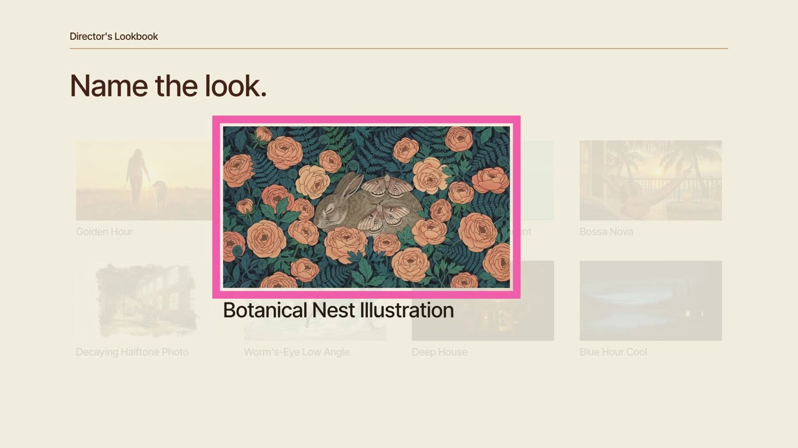

# A film from one lookbook hand



A 16-second film made with [OpenFilm](https://github.com/openfilm/openfilm) from one hand of the
[Director's Lookbook](https://directorslookbook.app), a library of named styles for image, video and music prompts.
The music comes from the hand's score card, and every cut lands on its beat.

```sh
git clone https://github.com/qxxx5vyd77-byte/lookbook-openfilm-example && cd lookbook-openfilm-example
npx -y openfilm@latest open .
```

Studio opens the film; `npx openfilm render` makes the MP4.

## What it shows

- **One hand, one look.** Swiss Neo-Grotesque (type), Swiss Motion Graphics (film), Coffee and Fluoro Pink (colour),
  Deep House (score) and four camera cards. `look.css` is the brief's LOOK.CSS block, unchanged: the palette as
  custom properties, the type as tokens.
- **Camera cards as moves.** Each full-frame look runs its card's `frame(t)` recipe from the brief's FILM PLAN:
  Dolly Push-In, Slow Pan (overscaled so no edge shows) and Pull-Back Reveal. A Whip Pan leaves the opener and lands
  on the first look.
- **Cuts on the beat.** The film is 32 beats. Every page reads `assets/beats.json` in `ready` and times its words
  and moves to beats, so a new track re-times the whole film.

## Five soundtracks

`scores/` holds beds for five score cards, each cut from its own track and matched at -14 LUFS:

| Score card | Tempo | Film |
|---|---|---|
| Deep House (the hand's own) | 122.2 bpm | 15.7 s |
| 60s Spy Lounge | 120.1 bpm | 16.0 s |
| Synthwave | 101.8 bpm | 18.9 s |
| Amapiano | 112.9 bpm | 17.0 s |
| City Pop | 116.0 bpm | 16.6 s |

```sh
python3 tools/score.py synthwave
```

re-times every cut, word and move to that track and swaps the bed. `python3 tools/score.py deep-house` puts the
hand's own score back.

## How the beats were measured

Each grid is fitted to the track's drum hits (`tools/beat/hits.py`), and beat 1 is the beat where the harmony
changes most (`tools/beat/downbeat.py`). A grid fitted to the whole mix locked half a beat off on three of the five
tracks: in house and amapiano the off-beat hats outscore the kick. `tools/beat/fold.py` shows where the kick, the
hats and the sidechain dip sit inside a beat, which is how that showed up. The tools need Python 3, numpy and ffmpeg.

## How it was made

We dealt the hand from the lookbook's connector and asked `brief` for `tool: "openfilm"`. Next to the usual image,
video and music prompts, it returns a FILM PLAN (the stage, one page per shot, the `document.fonts.load` lines for
`ready`, each camera card as a `frame(t)` recipe) and a LOOK.CSS block. The connector needs no account:

```
https://lookbook-mcp.riverroadlabs.workers.dev/mcp
```

Every card, with pictures: [directorslookbook.app](https://directorslookbook.app).

## Change it

- **Another hand:** deal one from the connector, brief it for `openfilm`, and paste its LOOK.CSS over `look.css`.
- **Other words:** the opener is `scenes/shot-1.html`; the prompt phrases on the wording card are in
  `scenes/shot-5.html`.
- **Other looks:** the pictures are in `assets/looks/`; each look shot names its picture and move in
  `scenes/shot-2.html` to `scenes/shot-4.html`.
- **Another track:** add a bed to `scores/`, give its seconds per beat (`period`) and the second its first beat falls
  on (`in`) in `scores/scores.json`, then run `tools/score.py`.

## License

The code (film.html, the pages, look.css, tools) is MIT. The pictures and music are listed in [CREDITS.md](CREDITS.md).
